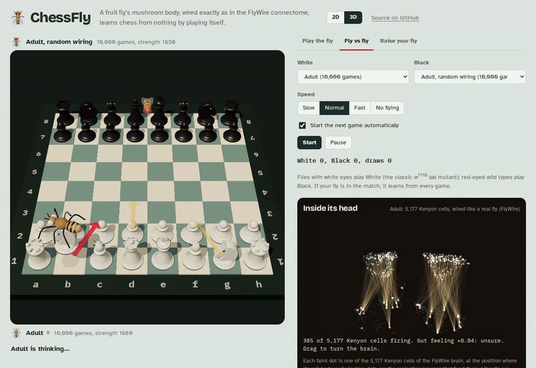
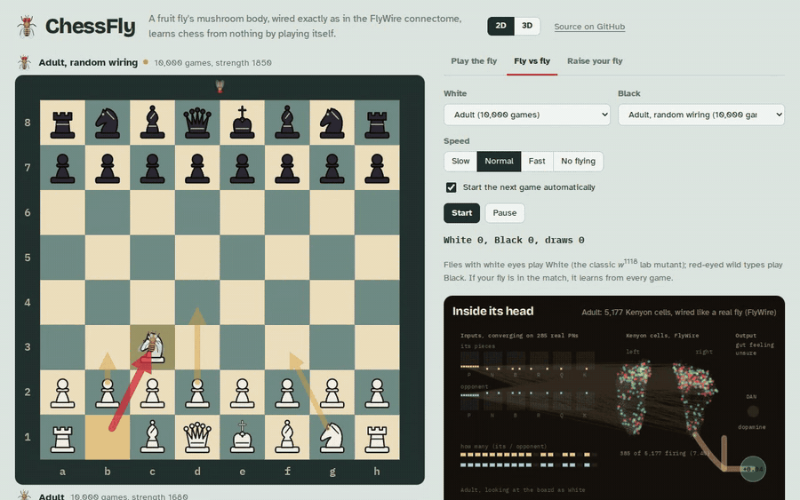
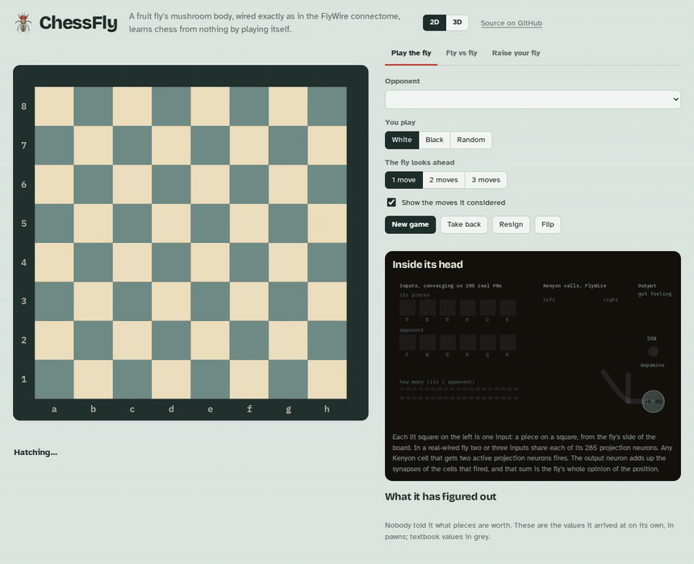
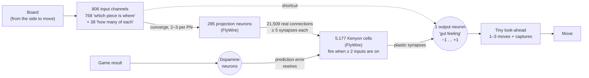
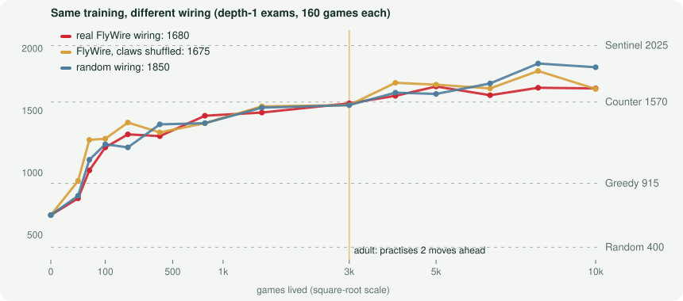
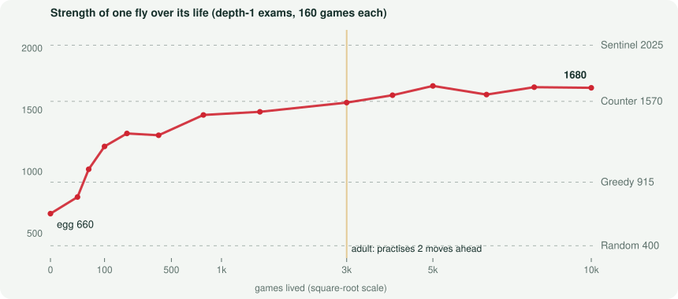

# ChessFly

**The real wiring of a fruit fly's learning centre, taken from the FlyWire connectome and hooked up to a chessboard. It hatches knowing nothing and teaches itself chess by playing itself, in 2D or 3D, right in your browser.**

<p align="center"></p>

**[▶ Play it in the browser](https://znatgost.github.io/chessfly/)** · no install, no server, no GPU

The mushroom body is the part of an insect brain that learns which smells mean sugar and which mean danger. ChessFly takes the input wiring of a real one: all **285 olfactory projection neurons, 5,177 Kenyon cells and the 21,509 connections between them** in the FlyWire whole-brain connectome of an adult female *Drosophila* (release v783, reconstructed from electron microscopy by machine learning and proofread by the FlyWire consortium). Here the "smells" are chess pieces. The model gets no chess knowledge at all: nobody tells it that a queen is worth more than a pawn, that the centre matters, or which openings are good. It knows the rules and gets a dopamine signal after every game saying how things turned out.

- After **50 games** the real-wired fly beats a player that always grabs the biggest capture, 69% of the time; after 200 games, 94%.
- By **5,000 games** its own price list reads knight 3.1, bishop 3.9, rook 5.4, queen 11.0 pawns. Nobody told it; chess books say 3, 3, 5 and 9.
- As an **adult** (10,000 games) it scores 61% against Counter, an engine that counts material with the same look-ahead. Let it look three moves ahead and it scores 88% against Sentinel, which counts material two moves ahead.
- **Real wiring vs random wiring:** the real FlyWire wiring learns chess exactly as well as the same cells with their inputs shuffled, and a little worse than the original random design. [Details below.](#real-wiring-vs-random-wiring)

You can play against it, watch two flies play each other, or hatch your own fly and raise it from an egg while you watch its Kenyon cells light up.

## Three ways to use it, in 2D or 3D

| | |
|---|---|
| **Play the fly** | Pick a fly (a hatchling, a larva, a pupa, the adult, the random-wired adult, or your own) and play it. It shows the moves it was weighing as arrows. Your own fly learns from every game you finish against it. |
| **Fly vs fly** | Put any two flies in the ring. By default it is the real-wired adult against the random-wired one. White-eyed flies play White (the famous *w*<sup>1118</sup> lab mutant), red-eyed wild types play Black. The fly flies over, picks up a piece and carries it to its square. Checkmate earns a *six-seven* 🤲 victory dance. |
| **Raise your fly** | Self-play training in a Web Worker: about ten games a second while it is young, a few a second once it is an adult and thinks further ahead. Watch it go egg → larva → pupa → adult, watch its piece values appear, and watch its strength climb on the exam chart. You choose whether the egg gets real FlyWire wiring or random wiring. Its brain is saved in your browser; you can export it as a small JSON file and load it anywhere. |

**2D or 3D.** The switch in the header swaps the flat board for a three.js scene with turned wooden-style pieces and a 3D fly that flies over, grips a piece and carries it. In 3D the brain panel shows the mushroom body in 3D too: every Kenyon cell body at the position where it sits in the real FlyWire brain, the projection neurons that feed them, and the real connections lighting up for the position on the board. Drag to turn the board or the brain.

<p align="center"></p>

<p align="center"></p>

## How it works



**Inputs.** The board is described by 768 channels, one for every combination of piece, colour and square, seen from the side to move (the board is mirrored for Black, so one brain learns both colours), plus 38 "how many" channels: one fires for "I have at least one knight", another for "at least two", and so on. They carry the same information as the board, just in a form that makes counting easy, and they say nothing about what anything is worth.

**Projection neurons.** In a fly, dozens of receptor types converge on about 50 glomeruli, and projection neurons carry that code into the mushroom body. In ChessFly the 768 board channels converge onto the 285 projection neurons that FlyWire shows reaching Kenyon cells, two or three channels each, fixed at random when the egg is laid. So one real projection neuron might fire for "my knight on f3" or for "their pawn on h5": broadly tuned, like a real one.

**Kenyon cells: the real wiring.** Each Kenyon cell listens to exactly the projection neurons it is connected to in FlyWire (every connection of at least 5 synapses, the usual FlyWire threshold): 4.6 inputs on average (anatomists count about 6 to 7 "claws" per cell; the difference is the weaker connections left out here). A Kenyon cell fires when at least two of its inputs are active. 454 of the 5,177 cells have no connection of that strength from an olfactory projection neuron (many of them listen to other senses, such as vision), so they never fire here. For a typical middlegame position about 7% of the cells fire; in a real fly an odour switches on roughly 5–10% of them. The wiring never changes during the fly's life.

**Output neuron.** A single mushroom body output neuron (MBON) adds up the synapses of the Kenyon cells that fired. Its activity, squashed to between −1 and +1, is the fly's entire opinion of a position. There is no other evaluation anywhere in the program.

**Dopamine.** Learning happens only at the Kenyon cell → output synapses, as in the insect mushroom body, where dopamine neurons change exactly these synapses (Aso et al. 2014; Hige et al. 2015). After each game ChessFly walks back through every position of it and nudges each one's value toward what actually happened next, using temporal-difference learning, TD(λ) with λ = 0.7, the method behind TD-Gammon (Tesauro 1995). The "dopamine" is the prediction error: *better than I expected* strengthens the synapses of the cells that were active, *worse than expected* weakens them. Only the synapses of cells that were firing change.

**The search.** Pure instinct cannot see that a piece is about to be taken, so the fly also looks a little ahead: a plain alpha-beta search 1 to 3 moves deep, plus captures until things calm down. It is ordinary engine code with no chess knowledge in it, so the fly's strength comes from the quality of its gut feeling. Young flies practise with 1 move of look-ahead; from adulthood (3,000 games) they practise with 2, which makes their games, and so their lessons, better.

**Rewards.** A win is +1, a loss −1, a draw 0. While training, games that reach 200 moves without a result are stopped and scored by material. That is the only place material values appear in the whole program, and it is what gives an egg its very first hint.

**How long it takes.** An adult takes about 2 minutes on one CPU core for its first 3,000 games and about half an hour for the next 7,000, which it plays thinking two moves ahead. A browser tab is in the same range.

## Real wiring vs random wiring

Does it matter that the wiring is the real one? Neuroscientists have argued that the fly's projection neuron → Kenyon cell wiring is close to random, and that random wiring is close to ideal for this kind of learning (Caron et al. 2013; Litwin-Kumar et al. 2017). ChessFly can test that on chess. Three flies went through exactly the same life: the same self-play schedule, the same learning rule, the same random seed, the same exams. Only the wiring differs:

- **Real (FlyWire):** the 5,177 Kenyon cells with their real inputs.
- **Shuffled claws:** the same 5,177 cells with the same number of inputs each, but every input re-drawn at random from the same projection neurons. This is the classic control for connectome wiring.
- **Random:** the original ChessFly design, 4,000 cells with 7 random inputs each straight from the board channels.

<p align="center"></p>

After 10,000 games each, bigger exams (the same fixed opponents, 100 games each) and a head-to-head round robin between the three adults:

| Wiring | Games lived | vs Counter | vs Sentinel | Rating (200 exam games) |
|---|---:|---:|---:|---:|
| Real (FlyWire) | 10,000 | 61% (+38 =46 −16) | 18% (+8 =20 −72) | **1690** |
| Shuffled claws | 10,000 | 61% (+40 =42 −18) | 19% (+10 =18 −72) | **1695** |
| Random | 10,000 | 69% (+46 =45 −9) | 24% (+10 =27 −63) | **1755** |

Head to head, 100 games per pair, colours alternating, both look 1 move ahead:

| row scores against column | Real (FlyWire) | Shuffled claws | Random |
|---|---:|---:|---:|
| **Real (FlyWire)** | — | 53% | 35% |
| **Shuffled claws** | 47% | — | 36% |
| **Random** | 66% | 65% | — |

**The verdict.** The real wiring and the shuffled control are indistinguishable (1690 vs 1695, and 53% to 47% head to head, well within luck). So for learning chess, the particular pattern of connections in a real fly brings no advantage over a random pattern with the same numbers, which is what the "random is near-optimal" theory predicts. The original random design is a bit stronger (about +60 rating points, and 65% head to head). The likely reason is not realism but capacity: its Kenyon cells have 7 inputs instead of 4.6, and each board channel has its own projection neuron, while in the real-wired fly two or three channels have to share one of 285 real projection neurons, which blurs the picture. You can watch the real-wired and random-wired adults play each other in *Fly vs fly*; it is the default match.

## Its life, measured

Every few hundred games the fly sits an exam: 40 games (colours alternating, no learning) against each of four fixed opponents that never change.

| Opponent | What it does | Rating |
|---|---|---|
| Random | picks any legal move | 400 (by definition) |
| Greedy | takes the most valuable piece it can, mates in one if it sees it, otherwise random | 915 |
| Counter | counts material, looks 1 move ahead plus captures | 1570 |
| Sentinel | counts material, looks 2 moves ahead plus captures | 2025 |

The ratings come from matches between the bots themselves (`npm run calibrate`), anchored so that Random is 400. They are ChessFly's own scale, not FIDE or chess.com ratings. In exams the fly always looks just 1 move ahead, the same as Counter, so it can only beat Counter by *understanding positions better than "count the pieces"*.

The shipped real-wired adult's life:

<p align="center"></p>

Win rates count a draw as half a win.

| Games lived | Stage | Rating | vs Random | vs Greedy | vs Counter | vs Sentinel |
|---:|---|---:|---:|---:|---:|---:|
| 0 | egg | **660** | 84% | 10% | 8% | 0% |
| 25 | larva | **795** | 88% | 26% | 11% | 0% |
| 50 | larva | **1020** | 93% | 69% | 5% | 0% |
| 100 | larva | **1205** | 100% | 83% | 13% | 0% |
| 200 | larva | **1310** | 98% | 94% | 19% | 0% |
| 400 | pupa | **1295** | 99% | 94% | 14% | 1% |
| 800 | pupa | **1460** | 99% | 95% | 39% | 1% |
| 1,500 | pupa | **1485** | 99% | 98% | 40% | 3% |
| 3,000 | adult | **1560** | 100% | 96% | 51% | 5% |
| 4,000 | adult | **1620** | 100% | 95% | 50% | 19% |
| 5,000 | adult | **1695** | 98% | 99% | 66% | 16% |
| 6,500 | adult | **1625** | 99% | 100% | 56% | 10% |
| 8,000 | adult | **1685** | 96% | 99% | 60% | 23% |
| 10,000 | adult | **1680** | 99% | 99% | 61% | 18% |

**What it figured out about the pieces.** ChessFly can ask its own brain what each piece is worth: take a few ordinary positions, remove one piece at a time and measure how much the output neuron's opinion drops. Nobody gave it these numbers:

| Games lived | ♞ Knight | ♝ Bishop | ♜ Rook | ♛ Queen |
|---:|---:|---:|---:|---:|
| 200 | 2.1 | 1.4 | 2.0 | 7.9 |
| 400 | 2.1 | 1.1 | 3.3 | 6.8 |
| 800 | 2.3 | 1.6 | 3.4 | 7.4 |
| 1,500 | 2.1 | 2.3 | 4.2 | 7.3 |
| 3,000 | 1.7 | 2.1 | 2.6 | 6.1 |
| 4,000 | 3.0 | 3.6 | 5.3 | 10.2 |
| 5,000 | 3.1 | 3.9 | 5.4 | 11.0 |
| 6,500 | 2.9 | 3.6 | 4.9 | 10.0 |
| 8,000 | 3.5 | 4.6 | 6.4 | 13.2 |
| 10,000 | 4.2 | 6.0 | 8.1 | 17.0 |
| *textbook* | *3* | *3* | *5* | *9* |

The order and the ratios settle early; the scale drifts upward later (by 10,000 games it rates a pawn lower than books do, so every piece looks "more expensive"), but a rook stays worth about two knights and a queen about two rooks. At 200 games it still thought a bishop was worth less than a knight.

**Look-ahead.** The same adult brain gets much stronger when it thinks further ahead:

| Look-ahead | vs Counter | vs Sentinel | Rating |
|---|---:|---:|---:|
| 1 move (the exam setting) | 61% (+38 =46 −16) | 18% (+8 =20 −72) | 1690 |
| 2 moves | 99% (+39 =1 −0) | 46% (+16 =5 −19) | ≈ 2035 |
| 3 moves | 100% (+20 =0 −0) | 88% (+16 =3 −1) | ≈ 2380 |

Ratings above Sentinel's are extrapolated from lopsided scores and should be read as "clearly stronger than every exam opponent", nothing more precise. In *Play the fly* you choose how far it looks; in *Fly vs fly* the flies look two moves ahead.

## Honest notes

- **Real wiring, toy brain.** The projection neuron → Kenyon cell wiring is real: every connection comes from FlyWire. Everything after it is a model. A real mushroom body has about 35 output neurons of 21 types and some 20 types of dopamine neuron, arranged in 15 compartments; ChessFly has one output neuron and one dopamine signal. Real projection neurons carry smells; here chess squares are assigned to them at random.
- **Both mushroom bodies at once.** FlyWire's 5,177 Kenyon cells are the left and right mushroom bodies together; ChessFly treats them as one pool.
- **The shortcut.** The input channels also connect straight to the output neuron. Real projection neurons do not synapse on mushroom body output neurons; this path lets the egg learn piece values much faster, and it is the same in all three wirings.
- **The search is not a fly.** No insect looks three moves ahead. The look-ahead is standard engine code; everything it knows, it gets from the output neuron.
- **Scores are noisy.** Each regular exam is 160 games, so single points on the charts move by ±60 rating points from luck alone.
- **Sibling project.** [FLY67](https://github.com/znatgost/fly67) runs the *whole* FlyWire brain (138,639 neurons) as a spiking model driving a virtual fly.

## Run it yourself

It is plain HTML and JavaScript modules with no build step.

```sh
git clone https://github.com/znatgost/chessfly && cd chessfly
python3 -m http.server 8000        # then open http://localhost:8000
```

Opening `index.html` directly from disk will not work, because browsers block module workers on `file://`.

```sh
npm test                                   # perft, brain tests, and a real-wired egg that learns from scratch
node tools/train.mjs --wiring flywire --games 10000 --out brains --tag myfly --exams 0,100,1000,5000,10000
node tools/compare.mjs 100 brains/adult.json brains/adult-shuffled.json brains/adult-random.json
npm run build-data                         # re-extract data/mushroom_body.json from FlyWire (~200 MB download)
npm run build-three                        # rebuild the trimmed three.js bundle in src/vendor
```

The GitHub Actions workflow runs the move generator against the standard perft positions, checks the incremental evaluation against a full one at 176,000 search nodes for all three wirings, checks the FlyWire wiring against the data file, and hatches fresh eggs on every push (real and random wiring) to check that 1,000 self-play games are enough for them to value pieces in the right order and beat Random and Greedy.

**Publishing on GitHub Pages:** push the repository, then in *Settings → Pages* choose *Deploy from a branch*, branch `main`, folder `/ (root)`.

## Files

```
index.html                  the page
data/mushroom_body.json     the real wiring: 285 PNs, 5,177 KCs, 21,509 connections, cell types, soma positions
src/chess.js                rules: 0x88 board, legal moves, draws, FEN, SAN (perft-verified)
src/brain.js                the mushroom body: real / shuffled / random wiring, dopamine learning, incremental evaluation
src/search.js               alpha-beta + quiescence look-ahead on top of the fly's gut feeling
src/training.js             self-play, TD(λ) learning, exams, Elo estimate
src/players.js              the fly and the four exam opponents
src/insight.js              asks a brain what it thinks each piece is worth
src/worker.js               runs thinking and training off the main thread
src/app.js                  the interface
src/board.js, board3d.js    the 2D (SVG) and 3D (three.js) boards, with the fly that carries the pieces
src/brainview.js, brain3d.js  the live brain panel in 2D and 3D
src/fly.js, pieces.js       the fly and the chess pieces, drawn for this project
src/vendor/three.js         three.js r186, trimmed to the parts used (tools/build_three.sh)
brains/                     the shipped flies: larva, pupa, adult (real wiring), plus the shuffled and random-wired adults (about 30 KB each, exam history included)
tools/                      FlyWire extraction, training, comparison, calibration, charts, GIF capture
test/                       perft, brain and learning tests
```

## Data and references

The wiring in `data/mushroom_body.json` is derived from the FlyWire connectome, release v783. If you use it, please cite the FlyWire papers and follow FlyWire's data terms.

- Dorkenwald S et al. (2024). Neuronal wiring diagram of an adult brain. *Nature* 634, 124–138.
- Schlegel P et al. (2024). Whole-brain annotation and multi-connectome cell typing of *Drosophila*. *Nature* 634, 139–152.
- Shiu PK et al. (2024). A *Drosophila* computational brain model reveals sensorimotor processing. *Nature* 634, 210–219. (Source of the packaged v783 connectivity.)
- Caron SJC, Ruta V, Abbott LF, Axel R (2013). Random convergence of olfactory inputs in the *Drosophila* mushroom body. *Nature* 497, 113–117.
- Aso Y et al. (2014). The neuronal architecture of the mushroom body provides a logic for associative learning. *eLife* 3, e04577.
- Hige T, Aso Y, Modi MN, Rubin GM, Turner GC (2015). Heterosynaptic plasticity underlies aversive olfactory learning in *Drosophila*. *Neuron* 88, 985–998.
- Litwin-Kumar A, Harris KD, Axel R, Sompolinsky H, Abbott LF (2017). Optimal degrees of synaptic connectivity. *Neuron* 93, 1153–1164.
- Tesauro G (1995). Temporal difference learning and TD-Gammon. *Communications of the ACM* 38(3), 58–68.
- Baxter J, Tridgell A, Weaver L (2000). Learning to play chess using temporal differences. *Machine Learning* 40, 243–263.

## License

MIT for the code, the chess pieces and the fly. three.js is MIT. The fonts in `src/fonts` are under the SIL Open Font License. The FlyWire-derived data follows FlyWire's own terms.
